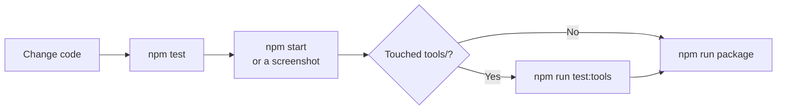

# Changing, forking and extending

Thanks for picking this up. This guide gets you from a bare Mac to a running, changed, packaged app.
You don't need to have seen the project before. If you're using a coding agent, point it at
[AGENTS.md](AGENTS.md); it covers the same ground in a form agents follow well.

**On this page:** [Set up a Mac from scratch](#set-up-a-mac-from-scratch) ·
[Make it your own (fork checklist)](#make-it-your-own-fork-checklist) · [Everyday workflow](#everyday-workflow) ·
[Where to change what](#where-to-change-what) · [Rules that protect the family's videos](#rules-that-protect-the-familys-videos) ·
[This repository is public](#this-repository-is-public) · [Style](#style) · [Before you share a change](#before-you-share-a-change) · [Sharing the app](#sharing-the-app)

## Set up a Mac from scratch

1. **Install Homebrew** from [brew.sh](https://brew.sh) (copy the one-line command from its front page).
2. **Install the tools:**
   ```bash
   brew install node@22 ffmpeg uv git
   ```
   Already use nvm? `nvm install 22` works instead of `node@22`; the repo's `.nvmrc` selects it.
3. **Get the code:**
   ```bash
   git clone <repository URL> crystal-ball-themes
   ```
   ```bash
   cd crystal-ball-themes
   ```
4. **Install and set up:**
   ```bash
   npm install
   ```
   ```bash
   npm run setup
   ```
   `setup` renders the Halloween theme (drawn by code), plus any voiced theme whose pictures and
   voices you've made, then runs `npm run doctor`. A fresh copy has none of those pictures and voices:
   they're made with Gemini or any other model, see [docs/media.md](docs/media.md). Every required
   line should show ✓; anything marked ✗ comes with the command that fixes it.
5. **Run it:**
   ```bash
   npm start
   ```

You don't need the crystal ball to work on the app. Without it, everything works except putting
themes on the ball.

## Make it your own (fork checklist)

If you're publishing your own version, change these so it doesn't clash with the original:

| What | Where |
| --- | --- |
| App name (also names the data folder in `~/Library/Application Support/`) | `productName` in `package.json`, `APP_NAME` in `src/lib/paths.js`, and `name` in `tools/package.mjs` |
| Bundle id | `appBundleId` in `tools/package.mjs` |
| Author | `author` in `package.json`; the copyright line in `LICENSE`; `AUTHOR_EMAILS` in `test/repo-safety.test.js` |
| GitHub owner | The badges in `README.md`, `.github/CODEOWNERS`, `.github/ISSUE_TEMPLATE/config.yml` |
| Icon | `tools/make_icon.py`, then `npm run icon` |
| USB device name, if your ball is different | `USB_PRODUCT` in `src/lib/ball.js` (find yours with `ioreg -p IOUSB -w0`) |

## Everyday workflow



| Check | Command | How long |
| --- | --- | --- |
| Lint (mistakes and unsafe patterns) | `npm run lint` | Seconds |
| Logic tests (temporary folders, never your real themes), theme scripts, and the repo safety checks | `npm test` | Seconds |
| Theme tools still produce ball-ready video | `npm run test:tools` | A few minutes |
| Machine has everything | `npm run doctor` | Seconds |
| See the app | `npm start` | |
| Screenshot without clicking | `npx electron . --screenshot=dist/x.png --wait=4000` | Seconds |
| Screenshot a theme's sheet | add `--open=builtin/halloween` | |
| Screenshot the desktop preview | add `--preview=builtin/halloween` | |
| Use throwaway data | prefix with `CRYSTAL_BALL_DATA_DIR=$(mktemp -d)` | |
| Build the app | `npm run package` | About a minute |
| Check the built app is locked down | `npm run package:verify` | Seconds |
| What media the voiced themes need | `npm run media:plan` | Seconds |
| Safe to publish? (files and the whole history) | `npm run check:public` | Seconds |

Working with the real ball from Terminal: `npm run ball -- status`, `npm run ball -- apply <theme id>`,
`npm run ball -- eject`.

## Where to change what

| I want to… | Change |
| --- | --- |
| Add a built-in theme | See [docs/themes.md](docs/themes.md) |
| Change how the window looks | `src/renderer/styles.css`, `src/renderer/app.js` |
| Change the desktop preview | `src/renderer/preview.*`, `openPreview` in `src/main/main.js` |
| Add something the window can ask for | Logic in `src/lib/`, a handler in `registerIpc` (`src/main/main.js`), and an entry in `src/main/preload.js` |
| Change the video format | `src/lib/convert.js` and `tools/make_halloween.py` (`encode`); read [docs/hardware.md](docs/hardware.md) first |
| Change how the ball is found | `detectBall` in `src/lib/ball.js` |
| Change what happens on "Show on the ball" | `applyTheme` in `src/lib/apply.js` |
| Add a Terminal command | `src/cli.js` |
| Add a setup check | `tools/doctor.mjs` |

[docs/architecture.md](docs/architecture.md) explains how these pieces fit together.

## Rules that protect the family's videos

These keep the app safe for the people using it. Please don't break them.

1. **Never lose what's on the ball.** All writing to the ball goes through `applyTheme`, which saves
   anything new first.
2. **Only touch files inside the ball's `video` folder.** Never rename or delete the folder.
3. **Copy to the ball with `plainCopy`**, not Finder, `cp` or `fs.copyFile` (they create hidden `._`
   files the ball tries to play).
4. **Don't run `diskutil info` on the ball.** It hangs. Use `ioreg` and `mount` as `detectBall` does.
5. **Keep the exact video format** described in [docs/themes.md](docs/themes.md#the-rules-every-clip-follows).
6. **Deleting goes to the Bin**, never permanently.
7. **Don't write the ball's firmware.** One mistake can break the toy for good.
8. **Keep API keys out of git**, logs and screenshots. `.env` is git-ignored for this reason.

## This repository is public

Anything pushed here stays public, even after it's deleted, so a few extra rules apply. They're
explained in [SECURITY.md](SECURITY.md) and, with checklists, in
[.agents/skills/public-repo-safety/SKILL.md](.agents/skills/public-repo-safety/SKILL.md).

- **No keys, family videos, photos, names or home-folder paths**, in files, commit messages,
  screenshots or issues. `npm test` checks the files for you.
- **No generated pictures, voices or videos.** They're made locally from the scripts
  ([docs/media.md](docs/media.md)).
- **Don't weaken the app's locks** (sandbox, IPC checks, CSP, packaging allowlist and fuses).
- **New dependencies are rare.** Pin them, and pin any new GitHub Action to a full commit SHA.
- **Run `npm run check:public` before you push.**

CI runs on every pull request: lint, tests and a full fresh-clone setup on Apple silicon and Intel
Macs, plus secret scanning of the whole history, CodeQL, dependency review and workflow security
checks. Dependabot proposes updates weekly.

## Style

- **Code:** plain CommonJS JavaScript; no runtime npm dependencies (Electron, the packager and
  fuses are dev-only). `src/lib` must not import Electron. Python is only for the tools in `tools/`,
  with exact pins in `tools/requirements.txt`.
- **Tests:** `node:test`, in `test/`. Add or update a test with every change to `src/lib`. Tests use
  temporary folders, never the real data folder or a real ball.
- **Words in the app:** short, warm, and readable by a child. NZ English ("Bin", "colour").
- **Content:** kind, spooky-funny, and free of copyrighted characters (see
  [docs/themes.md](docs/themes.md#content-guidelines)).
- **Commits:** a short subject in the imperative ("Add a winter theme"), and a body that says why.

## Before you share a change

- [ ] `npm run lint` and `npm test` pass
- [ ] `npm run test:tools` passes, if you changed anything in `tools/`
- [ ] `npm run package && npm run package:verify` pass, if you changed `src/main/`, packaging or dependencies
- [ ] You looked at the change in the app (or a screenshot)
- [ ] Docs updated if behaviour changed (README, `docs/`, `AGENTS.md`)
- [ ] No keys, personal data or generated media in the commit, and `npm run check:public` passes before you push

## Sharing the app

Point people at the [Releases page](https://github.com/jpcaparas/crystal-ball-themes/releases) or the
download links at the top of the README. To publish a new release, bump `version` in `package.json`
and push to `main`; GitHub Actions builds, checks and publishes it.
[docs/releasing.md](docs/releasing.md) explains the whole process, the bundled ffmpeg, and why macOS
asks for **Open Anyway** the first time.

`npm run package` on your own Mac builds an app that opens fine there. It uses ffmpeg from Homebrew
unless you've run `npm run ffmpeg` to build the bundled one.
