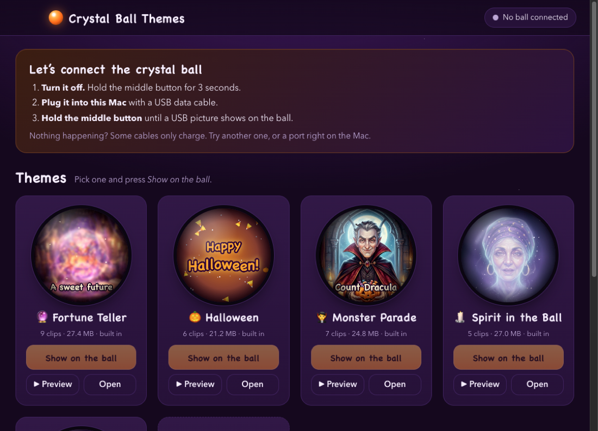
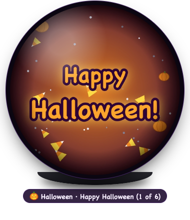
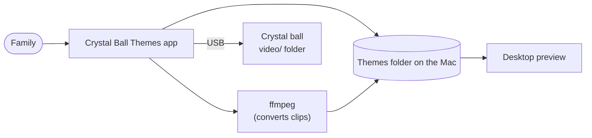

# Crystal Ball Themes

**Change what plays on a glowing "electronic crystal ball" in two clicks.**

A small Mac app for a toy sold as an *electronic crystal ball*: a 7 cm glass dome with a round
screen inside. Pick a theme, press **Show on the ball**, and the app puts the right videos on it in
exactly the format it needs, without ever losing what was there before. It's simple enough for kids.





It comes with built-in themes including talking monsters, a fortune teller and a spirit who floats
inside the ball. You can make your own from any videos, GIFs or photos, and preview any theme on
your desktop first.

**Contents:** [Pick your path](#pick-your-path) · [Does it work with my ball?](#does-it-work-with-my-ball) ·
[Using the app](#using-the-app) · [Themes](#themes) · [Build it yourself](#build-it-yourself) ·
[Commands](#commands) · [How it works](#how-it-works-in-one-picture) · [Troubleshooting](#troubleshooting) ·
[Words used here](#words-used-here) · [Credits and licence](#credits-and-licence)

<br clear="right" />

## Pick your path

| I want to… | Go to |
| --- | --- |
| Use the app with my crystal ball | [Using the app](#using-the-app) |
| Build and run it on my Mac | [Build it yourself](#build-it-yourself) |
| Change it, fork it, or send improvements | [CONTRIBUTING.md](CONTRIBUTING.md) |
| Make a new theme (drawn, voiced, or a talking head) | [docs/themes.md](docs/themes.md) |
| Understand how the code fits together | [docs/architecture.md](docs/architecture.md) |
| Know everything about the hardware | [docs/hardware.md](docs/hardware.md) |
| Work on this with a coding agent | [AGENTS.md](AGENTS.md). Any agent or tool that reads `AGENTS.md` will pick it up. |

## Does it work with my ball?

It was built for a ball that shows up on a Mac as:

- a USB drive containing a folder called `video`, and
- a USB device named **EVDO-M4** (maker ID `0x33C3`, ArtInChip).

Other video balls that are USB drives with a `video` folder will probably work too, because the app
also looks for "any FAT drive with a `video` folder". The manual that came with ours is labelled
**UM-ER-02**. Details are in [docs/hardware.md](docs/hardware.md).

## Using the app

### Show a theme on the ball

1. **Turn the ball off.** Hold the middle button for 3 seconds.
2. **Plug it into the Mac** with a USB-C cable that carries data. Some cables only charge.
3. **Hold the middle button** until a small USB picture appears on the ball. The app's top bar
   says **Ball connected**.
4. On any theme, press **Show on the ball**.
5. When it says **All set!**, press **Eject the ball**.
6. Unplug the ball, then hold the middle button to turn it on.

The ball plays every clip in the theme, one after another, over and over.

### Preview a theme on your desktop

Press **▶ Preview** on a theme. A pretend crystal ball floats on your desktop and plays the theme
with sound, the same way the real ball will. You don't need the ball plugged in.

- **Move it:** drag the ball. It stays on top of other windows.
- **Controls:** move the mouse over it for previous, play/pause, next, sound and close.
- **Keyboard:** <kbd>←</kbd> <kbd>→</kbd> change clip, <kbd>Space</kbd> pauses, <kbd>Esc</kbd> closes.

### Make your own theme

1. Press **+ New theme**, type a name and pick an emoji.
2. Drag in videos, GIFs or photos, or press **Choose files…**. MP4, MOV, GIF, JPG, PNG and iPhone
   photos all work. Photos become a 10-second slow zoom.
3. Choose how pictures fit the round screen: **Fill the circle** (crops the edges) or
   **Show the whole picture** (shrinks it to fit).
4. Press **Show on the ball**.

Deleting a clip or a theme moves it to the Bin, so it can always be recovered.

### The ball's buttons

| Button | Short press | Hold |
| --- | --- | --- |
| Middle | | 3 seconds: on or off. While plugged in: connect to the Mac. |
| Left | Previous clip | Quieter |
| Right | Next clip | Louder |

> **Why the first video is long.** The ball repeats whichever clip it's on until someone presses a
> button. So the app also joins each theme's clips into one long "play all" video and puts it first.
> The ball then shows everything by itself, and the buttons still skip to single clips.

## Themes

| Theme | What's in it |
| --- | --- |
| 🎃 **Halloween** | Six drawn animations with sound: "Happy Halloween!", a jack-o'-lantern, a friendly ghost, bats and the moon, eyes in the dark, and a bubbling cauldron. |
| 🧛 **Monster Parade** | Seven classic monsters say hello in their own voices: Count Dracula, the Headless Horseman, Frankenstein's creature, the Mummy, the Werewolf, the Witch and a shy ghost. |
| 🔮 **Fortune Teller** | Madame Zara looks into her crystal ball and tells nine kind, funny fortunes. |
| 🕯️ **Spirit in the Ball** | Madame Zara's spirit floats *inside* the ball, blinking and mouthing five spooky rhymes, lip-synced to her voice. |
| 🌙 **Midnight Séance** | A younger Madame Zara's spirit, silver hair drifting through the mist and glowing ghostly green inside the ball, with ten fortunes, riddles and rhymes. |
| 🦇 **Nightmare Before Christmas** | Starts empty, for clips or pictures you own. |
| 💾 **Saved from ball** | Made automatically the first time you replace videos the app hasn't seen before (like the ones the ball came with), so you can always put them back. |

The last two are created on your Mac as you use the app. Want another theme? See
[docs/themes.md](docs/themes.md).

## Build it yourself

You need a Mac. Copy each command into Terminal, one at a time.

**1. Install the tools** (skip any you already have):

| Tool | Why | Install |
| --- | --- | --- |
| [Homebrew](https://brew.sh) | Installs the others | See the Homebrew website |
| Node.js 22.19+ | Runs the app | `brew install node@22`, or `nvm install 22` |
| ffmpeg | Converts video | `brew install ffmpeg` |
| uv | Runs the Python theme tools | `brew install uv` |
| git | Downloads the code | `xcode-select --install` |

**2. Get the code and set it up:**

```bash
git clone <this repository's URL> crystal-ball-themes
```

```bash
cd crystal-ball-themes
```

```bash
npm install
```

```bash
npm run setup
```

`npm run setup` renders the built-in theme videos (no API key needed; it uses saved art and voices)
and then runs `npm run doctor`, which checks everything is in place and tells you how to fix anything
that isn't.

**3. Run it:**

```bash
npm start
```

**4. Make a real Mac app** (optional):

```bash
npm run package
```

```bash
ditto "dist/Crystal Ball Themes-darwin-arm64/Crystal Ball Themes.app" ~/Applications/"Crystal Ball Themes.app"
```

The app is unsigned, which is fine on the Mac that built it. To give it to someone else, see
[CONTRIBUTING.md](CONTRIBUTING.md#sharing-the-app).

## Commands

| Command | What it does |
| --- | --- |
| `npm start` | Run the app from the source code |
| `npm run setup` | Render built-in themes, then check the machine |
| `npm run doctor` | Check this Mac has everything, with fixes for anything missing |
| `npm test` | Fast tests of the app's logic, including real video conversions |
| `npm run test:tools` | Check every theme tool end to end (a few minutes; no API key) |
| `npm run ball -- status` | What's connected, and which theme is on the ball |
| `npm run ball -- themes` | List themes and their ids |
| `npm run ball -- apply builtin/halloween` | Put a theme on the ball from Terminal |
| `npm run ball -- add user/<id> clip.mp4 [--fit]` | Add files to one of your themes |
| `npm run ball -- eject` | Eject the ball |
| `npm run themes` | Re-render all built-in themes (`themes:halloween`, `themes:monsters`, `themes:fortunes`, `themes:spirit`, `themes:seance` for one) |
| `npm run icon` | Re-draw the app icon |
| `npm run screenshot` | Open the app, save `dist/screenshot.png`, close |
| `npm run package` | Build the Mac app into `dist/` |

## How it works, in one picture

The ball is a USB drive that plays MP4 files from a folder called `video`. The app keeps themes on
the Mac, converts clips with ffmpeg, and writes them into that folder safely.



More diagrams and the full code map are in [docs/architecture.md](docs/architecture.md).

## Troubleshooting

| What you see | What to try |
| --- | --- |
| "No ball connected" | Turn the ball off, plug it in, and hold the middle button until the USB picture shows. |
| Still nothing | Use another cable (many only charge), and plug straight into the Mac rather than a hub or monitor. |
| The ball only ever shows the first clip | Put the theme on again. Older versions didn't add the "play all" video. |
| "Couldn't join the clips" | Install ffmpeg (`brew install ffmpeg`), then press Show on the ball again. |
| A file won't add | It may be damaged or have no picture. Try a different file. |
| "Couldn't eject" | Close any Finder window showing the ball, wait a few seconds, and try again. |
| A built-in theme says "No clips yet" | Run `npm run themes` (from source), then rebuild the app. |
| Anything else when building | Run `npm run doctor` and follow what it says. |

## Words used here

| Word | Meaning |
| --- | --- |
| **Ball** | The crystal ball toy. To the Mac, it's a USB drive. |
| **Theme** | A set of clips that go on the ball together, like "Halloween". |
| **Clip** | One video in a theme. |
| **Play-all video** | A theme's clips joined into one long video, so the ball shows them all without button presses. |
| **Built-in theme** | Comes with the app and can't be changed in the app. |
| **Your theme** | One you made in the app. You can add and remove clips. |
| **Voiced theme** | A theme whose characters talk, made from a script with generated art and voices. |
| **Eject** | Safely disconnect the ball so nothing gets corrupted. |

## Credits and licence

- **Code:** MIT licence, see [LICENSE](LICENSE). Fork it, change it, share it.
- **Halloween animations, sounds and icon:** drawn by the scripts in `tools/`, part of this project.
- **Monster Parade, Fortune Teller and Spirit in the Ball:** pictures made with Google's Gemini
  (Nano Banana 2.1) and voices made with Gemini 3.8 Flash TTS, from the scripts in `tools/scripts/`.
  Characters are original or from public-domain stories (Dracula, the Headless Horseman,
  Frankenstein's creature).
- The Nightmare Before Christmas theme ships empty, for clips you own.
- Not affiliated with the ball's maker, ArtInChip, Google, or Disney.
