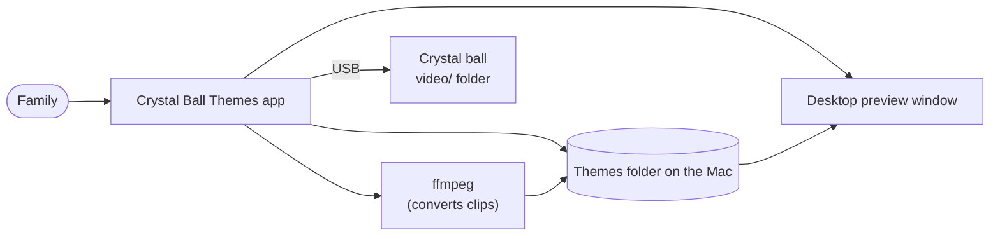
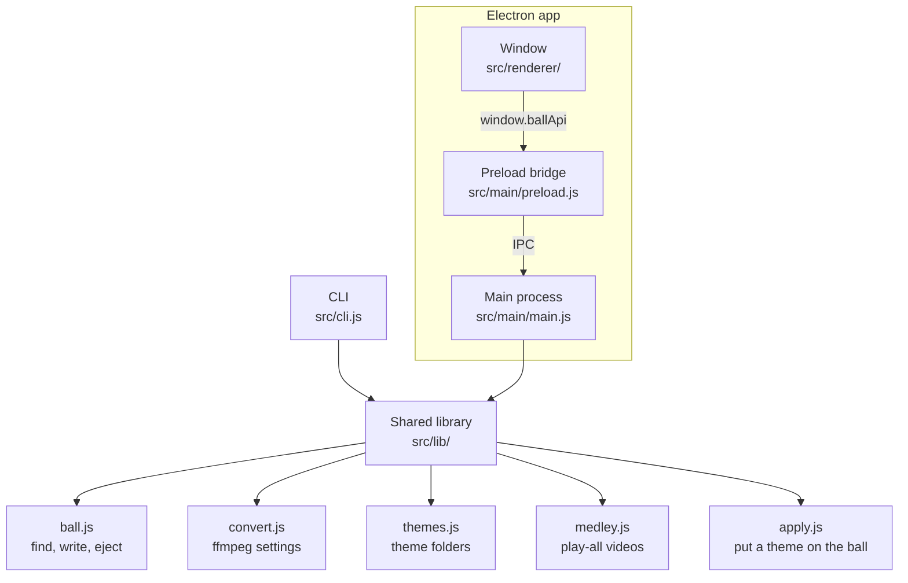
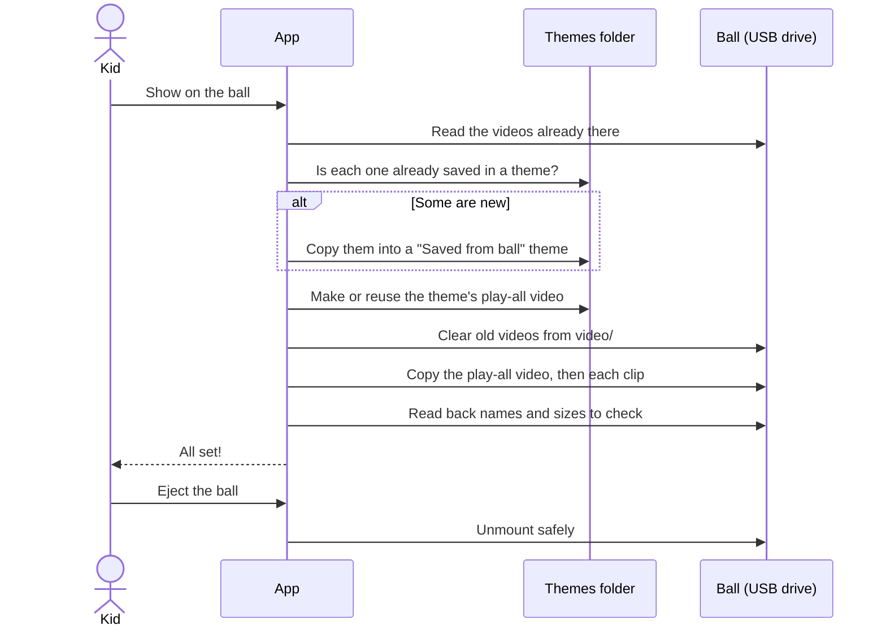
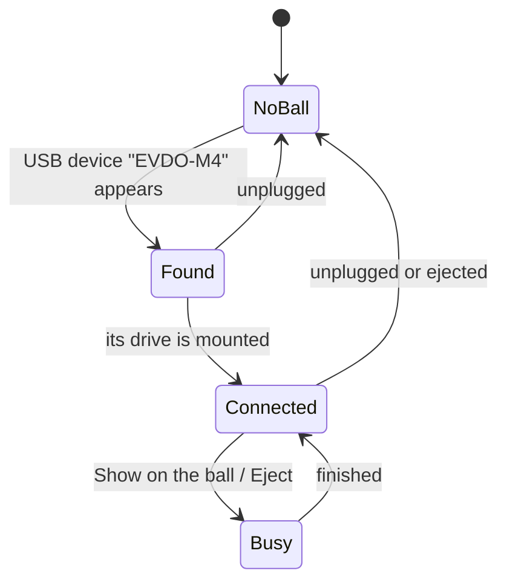
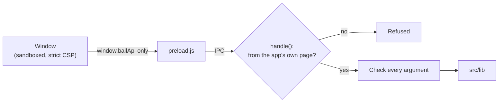
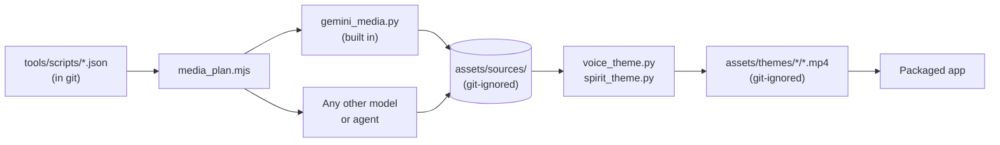

# How it works

This page explains how the app is put together, for anyone changing or extending it. If you only
want to use the app, the [README](../README.md) is enough.

**On this page:** [The idea](#the-idea) · [The pieces](#the-pieces) · [Code map](#code-map) ·
[Putting a theme on the ball](#putting-a-theme-on-the-ball) · [Finding the ball](#finding-the-ball) ·
[Themes and where they live](#themes-and-where-they-live) · [The play-all video](#the-play-all-video) ·
[Never losing videos](#never-losing-videos) · [The window and the main process](#the-window-and-the-main-process) ·
[The desktop preview](#the-desktop-preview) · [Making theme videos](#making-theme-videos)

## The idea

The crystal ball is, to a computer, a USB drive. Its built-in player plays the MP4 files in a
top-level folder called `video`. Nothing else about the ball can be controlled from a computer.

So the whole app is about one job: **put the right MP4 files into that folder, in exactly the
format the ball can play, without losing anything that was there.** Everything else (themes,
converting, previews) supports that job.

## The pieces



- **The app** is an [Electron](https://www.electronjs.org) app: a web page for the window, plus a
  Node.js "main process" that does the real work.
- **ffmpeg** converts any video, GIF or photo into the ball's format.
- **The themes folder** holds every theme as a plain folder of MP4 files.
- **The CLI** (`npm run ball -- …`) does the same jobs from Terminal, using the same code.

## Code map



| File | Its job |
| --- | --- |
| `src/lib/ball.js` | Find the ball (with `ioreg` and `mount`), list its videos, write clips safely, eject. |
| `src/lib/convert.js` | The ffmpeg settings for the ball's format; convert a file; join clips. |
| `src/lib/themes.js` | Read, create, rename and delete themes; add and remove clips; save videos from the ball; the hash index. |
| `src/lib/medley.js` | Make and cache each theme's play-all video. |
| `src/lib/apply.js` | Put a theme on the ball, step by step; work out which theme is on it now. |
| `src/lib/paths.js` | Where data and built-in themes live (both can be overridden for tests). |
| `src/main/main.js` | Electron main process: windows, ball polling every 2 s, and the handlers the window can call. |
| `src/main/preload.js` | The small, fixed list of actions the window is allowed to ask for (`window.ballApi`). |
| `src/renderer/index.html`, `app.js`, `styles.css` | The main window. |
| `src/renderer/preview.html`, `preview.js`, `preview.css` | The floating desktop preview. |
| `src/cli.js` | The Terminal version of the app's actions. |
| `tools/` | Python and Node tools that make theme videos and the icon, the media plan, packaging (`package.mjs`, `verify_package.mjs`), `doctor` and the tools smoke test. |
| `test/` | Tests for `src/lib`, the theme scripts and media plan, and the repo safety checks, run with `npm test`. |
| `.github/` | CI, CodeQL, Scorecard and Dependabot. |
| `.agents/skills/` | Task instructions for coding agents, such as keeping this public repository safe. |

**Rule of thumb:** `src/lib` never imports Electron. That keeps the CLI and the tests running the
exact same logic as the app.

## Putting a theme on the ball

Each step must succeed before the next starts. If anything fails, the app says so, and nothing is
reported as done.



The code is `applyTheme` in `src/lib/apply.js`. Writing to the ball happens in `writeClips` in
`src/lib/ball.js`, which:

- only touches regular files inside `video/`, never the folder itself or anything else on the drive;
- copies with plain streams and `fsync` (not `fs.copyFile`), because macOS would otherwise add
  hidden `._name.mp4` files that the ball tries to play;
- removes any `._*` and `.DS_Store` files it finds;
- checks there's enough free space before deleting anything.

## Finding the ball



`detectBall` asks `ioreg` for the USB device named `EVDO-M4` and the disk names under it, then reads
`mount` to find where that disk is mounted. If no such device exists, it falls back to any FAT
drive in `/Volumes` with a top-level `video` folder. It never calls `diskutil info`, which hangs on
this device.

## Themes and where they live

A theme is a folder of MP4 files plus a `theme.json`:

```json
{ "name": "Halloween", "emoji": "🎃", "note": "Shown under the title", "titles": { "01-x.mp4": "Pretty title" } }
```

Clips play in file-name order, so files start with `01-`, `02-` and so on.

| Kind | Id looks like | Lives in | Can be changed in the app? |
| --- | --- | --- | --- |
| Built-in | `builtin/halloween` | `assets/themes/<slug>/` (inside the app) | No |
| Yours | `user/nightmare-before-christmas` | `~/Library/Application Support/Crystal Ball Themes/themes/<slug>/` | Yes |

Every id goes through `ThemeStore.resolve`, which accepts only `builtin/<slug>` or `user/<slug>`
with lowercase letters, numbers and dashes. That stops an id from pointing anywhere else on disk.

Set `CRYSTAL_BALL_DATA_DIR` to use a different data folder (the tests always do).

## The play-all video

The ball repeats the file it's playing until someone presses a button. So for every theme with two
or more clips, the app joins the clips into one video and puts it first on the ball as
`00-<theme>-all.mp4`. The single clips go after it, so the dial can still pick one.

- `ensureMedley` in `src/lib/medley.js` makes the video with ffmpeg (re-encoding, so clips from
  different sources join cleanly).
- It's cached in the data folder under `medleys/`. Its file name includes a key made from the
  theme's clips, so changing a theme makes a fresh one and deletes the old one.
- If ffmpeg is missing, the clips still go on the ball, and the app explains that only the first
  clip will repeat.

## Never losing videos

Before replacing what's on the ball, `applyTheme` takes the SHA-256 of every video on it and looks
each one up in the **hash index**: a map of every clip and play-all video the app knows, built by
`ThemeStore.hashIndex` and cached by path, size and modified time in `hash-cache.json`.

- Known videos can be replaced safely; a copy exists.
- Unknown videos are copied into a new **Saved from ball** theme first.
- An out-of-date play-all video (`00-*-all.mp4`) isn't saved again; it's only a copy of clips the
  app keeps.

The same index tells the app which theme is on the ball right now (`whatsOnBall`), which is how the
"On the ball" badge appears.

## The window and the main process

The window is a sandboxed web page with `contextIsolation` on, `nodeIntegration` off, and a strict
Content Security Policy. It can't touch files or USB. It asks the main process to do things through
`window.ballApi`, defined in `src/main/preload.js`:

| Call | What it does |
| --- | --- |
| `info()` | Is ffmpeg installed, where is the data folder, which version |
| `listThemes()`, `getTheme(id)` | Read themes (each clip has a `file://` URL for previews) |
| `createTheme(name, emoji)`, `updateTheme(id, changes)`, `removeTheme(id)` | Manage your themes (deleting goes to the Bin) |
| `addFiles(id, paths, fit)`, `removeClip(id, file)` | Add converted clips, or remove one |
| `pickFiles()`, `pathForFile(file)` | File picker, and the path of a dropped file |
| `revealTheme(id)` | Show a theme's folder in Finder |
| `ballStatus()`, `applyTheme(id)`, `eject()` | The ball |
| `openPreview(id)` | Open or update the desktop preview |
| `on(event, callback)` | Events: `ball:status`, `apply:progress`, `convert:progress`, `preview:show` |

To add a new action: write the logic in `src/lib/`, add a handler with `handle('name', …)` in
`registerIpc` in `main.js`, expose it in `preload.js`, then call it from the window. Validate every
argument in the handler: the window is trusted code, but the main process shouldn't rely on that.

### Locks



| Lock | Where |
| --- | --- |
| Every renderer is sandboxed, with context isolation and no Node.js | `app.enableSandbox()`, `secureWebPreferences` in `main.js` |
| No remote code or connections | The Content Security Policy in each HTML file |
| IPC answers only the app's own pages | `fromApp` and `handle` in `main.js` |
| Dropped or picked files must be absolute paths to existing files of a known media type | `themes:addFiles` in `main.js` |
| No navigation, redirects, pop-ups or `<webview>`, in any window | `web-contents-created` in `main.js` |
| Every permission request (camera, microphone...) is refused | `setPermissionRequestHandler` in `main.js` |
| Screenshot flags only work from source | `app.isPackaged` in `main.js` |
| The built app contains only allowlisted files | `SHIP` in `tools/package.mjs` |
| The app can't be used as Node.js (`ELECTRON_RUN_AS_NODE`, `NODE_OPTIONS`, `--inspect` off) | `FUSES` in `tools/package.mjs` |

`npm run package:verify` checks the last two on a built app, and CI runs it on every change. The
reasons and the reporting process are in [SECURITY.md](../SECURITY.md).

## The desktop preview

`openPreview` in `main.js` opens a frameless, transparent, always-on-top window showing
`src/renderer/preview.html`. It plays a theme's clips in order with sound, like the ball, and can be
dragged anywhere. Opening a preview for another theme reuses the same window.

## Making theme videos

Built-in themes are made by tools in `tools/`, not by the app. There are three kinds:

| Kind | Tool | Example |
| --- | --- | --- |
| Drawn animation | `tools/make_halloween.py` | Halloween |
| Voiced scenes | `tools/voice_theme.py` + a script in `tools/scripts/` | Monster Parade, Fortune Teller |
| Talking head | `tools/spirit_theme.py` + a script in `tools/scripts/` | Spirit in the Ball, Midnight Séance, Hollow Hill Parade |

[docs/themes.md](themes.md) explains each one and how to make your own.

Voiced and talking-head themes need generated pictures and voices, which aren't in git. The theme
scripts describe them completely, and `tools/media_plan.mjs` turns the scripts into a list any image
or speech model can work through ([docs/media.md](media.md)):



`npm run themes` renders every theme whose media exists and skips the others. The app hides a
built-in theme until it has clips.
