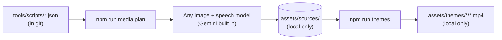

# Making the media (any model, any agent)

Generated media is **not** kept in this repository. Only the instructions for making it are. A fresh
clone contains the code and the theme scripts. The pictures and voice lines that the voiced and
talking-head themes need are made on your machine, by whichever image and text-to-speech models you
like, and then rendered into ball-ready videos offline.

**On this page:** [What's in git and what isn't](#whats-in-git-and-what-isnt) ·
[The media plan](#the-media-plan) · [The contract](#the-contract-every-item-must-meet) ·
[With the built-in Gemini tools](#with-the-built-in-gemini-tools) · [With any other model or agent](#with-any-other-model-or-agent) ·
[Then render](#then-render)

## What's in git and what isn't

| In git (source) | Not in git (made locally, git-ignored) |
| --- | --- |
| Code, tests and docs | Generated pictures and voice lines: `assets/sources/` |
| Theme scripts with every prompt, voice, acting note and line: `tools/scripts/*.json` | Rendered videos: `assets/themes/*/*.mp4` |
| The drawn Halloween animation, as code: `tools/make_halloween.py` | Play-all videos and caches in the app's data folder |
| Each theme's `theme.json` (names and titles) | The family's own themes and videos |
| The README screenshots and the app icon | API keys (`.env`) |



Halloween needs no generated media at all. It's drawn by code, so a fresh clone can always render it.

## The media plan

```bash
npm run media:plan
```

Shows, for each theme, how many pictures and voice lines exist and how many are missing. For the
full details, which are what an agent or model needs:

```bash
npm run media:plan -- --json --missing
```

Each item looks like this:

```json
{
  "theme": "monster-parade",
  "kind": "image",
  "output": "assets/sources/monster-parade/art/01-count-dracula.jpg",
  "prompt": "Kid-friendly spooky storybook illustration... An elegant old vampire count...",
  "inputs": [],
  "requirements": ["Square (1:1), at least 1024 x 1024 pixels.", "..."],
  "script": "tools/scripts/monster-parade.json",
  "present": false
}
```

| `kind` | What to make | Uses |
| --- | --- | --- |
| `image` | A new picture from `prompt`. If `inputs` lists a picture, use it as a reference so the character stays recognisable. | `prompt`, `inputs` |
| `image-edit` | An edit of the picture in `inputs` that changes **only** what `prompt` says (mouth half open, mouth open, eyes closed). Everything else must stay pixel-for-pixel in place, or lip-sync won't line up. | `prompt`, `inputs` |
| `speech` | The line in `text`, spoken word for word, in the character's `voice` and `style`. | `text`, `voice`, `style` |

Items are listed in the order they must be made: a head comes before its edits, and a theme whose
pictures reference another theme's picture comes after it.

## The contract every item must meet

- **Save it at `output`.** Pictures can be `.jpg`, `.png` or `.webp`; voice lines can be `.flac`,
  `.wav`, `.mp3`, `.m4a` or `.ogg`. The tools find whichever you saved.
- **Follow the item's `requirements`.** Pictures are square, with nothing important in the corners
  (the screen is round), and no text, frames or logos.
- **Speech is verbatim.** Words in `<angle brackets>` are performance cues (`<laugh>`, `<whispers>`,
  `<short pause>`), not words to say. Engines that don't understand them should act them out or skip them.
- **`voice` names are Gemini voices.** With another engine, pick a voice that fits `style` (the acting
  direction): age, mood and delivery matter more than the name.
- **Content rules:** kind, spooky-funny, safe for children at a front door. No copyrighted characters
  or real people's likenesses. See [themes.md](themes.md#content-guidelines).

## With the built-in Gemini tools

1. Put a Gemini API key in `.env` at the repo root (copy `.env.example`). It is git-ignored.
2. Run the theme's npm script, for example `npm run themes:monsters`. It makes any missing pictures and
   voice lines from the script, then renders. Or run `npm run themes` for everything.

The models are Nano Banana 2.1 (`gemini-nano-banana-2.1`) for pictures and Gemini 3.8 Flash TTS
(`gemini-3.8-flash-tts`) for voices. Override them with `CRYSTAL_BALL_IMAGE_MODEL` and
`CRYSTAL_BALL_TTS_MODEL`. Every run makes new pictures, so your theme will look a little different from
anyone else's. That's expected.

## With any other model or agent

1. Get the list: `npm run media:plan -- --json --missing > /tmp/todo.json`.
2. For each item, in order, make it with your tools and save it at its `output` path.
3. Check: `npm run media:plan` should show every theme as ✓.

That's all the render tools need. They never call an API for files that already exist.

## Then render

```bash
npm run themes
```

Renders every theme whose media is ready, and skips (with a note) any that isn't. To render one theme,
use its script: `themes:halloween`, `themes:monsters`, `themes:fortunes`, `themes:spirit`,
`themes:seance` or `themes:parade`. To render several scenes at once, add `--jobs`:
`npm run themes:parade -- --jobs 4`.

Then `npm run install-app` rebuilds the app with the new videos inside.
