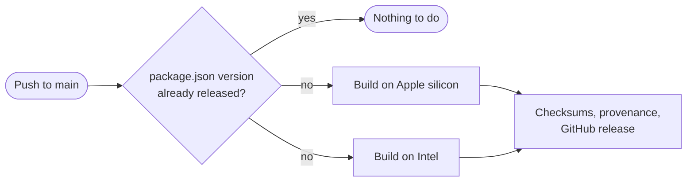

# Releases

Anyone can download the app from the
[Releases page](https://github.com/jpcaparas/crystal-ball-themes/releases) without building anything.
Releases are made automatically by GitHub Actions, in public, from the code in this repository.

**On this page:** [Making a release](#making-a-release) · [What a release contains](#what-a-release-contains) ·
[How it's built](#how-its-built) · [Why macOS asks the first time](#why-macos-asks-the-first-time) ·
[Checking a download](#checking-a-download) · [The bundled ffmpeg](#the-bundled-ffmpeg) · [Building one yourself](#building-one-yourself)

## Making a release

Change the version and push it to `main`:

```bash
npm version 1.1.0 --no-git-tag-version
```

```bash
git commit -am "Release 1.1.0" && git push
```

[`.github/workflows/release.yml`](../.github/workflows/release.yml) runs on every push to `main`. If
`package.json` has a version without a matching `v<version>` release, it builds and publishes one;
otherwise it does nothing. Use [semantic versions](https://semver.org): the last number for fixes,
the middle one for new features, the first for changes that break something people rely on.



Pull requests that change the release tooling get the same build as a dry run, without publishing.

## What a release contains

| File | What it is |
| --- | --- |
| `Crystal-Ball-Themes-mac-apple-silicon.dmg` | The app for Macs with an Apple chip (M1 and later) |
| `Crystal-Ball-Themes-mac-intel.dmg` | The app for Macs with an Intel processor |
| `SHA256SUMS.txt` | A checksum for every file |
| `crystal-ball-themes-v<version>.sigstore.json` | Signed build provenance: which workflow and commit built the files |
| `ffmpeg-sources.tar` | The exact source code of the bundled ffmpeg, and the script that builds it |

The file names never change between versions, so these links always fetch the newest release:
`https://github.com/jpcaparas/crystal-ball-themes/releases/latest/download/<file name>`. The README's
download links rely on that.

Each app comes with the Halloween theme and its own ffmpeg, so it can add clips and make play-all
videos on a Mac without Homebrew. The talking themes need generated pictures and voices, which
aren't in this repository ([media.md](media.md)), so releases don't include them.

## How it's built

On fresh GitHub-hosted Macs, one for each chip, with no build caches:

1. Build ffmpeg from pinned, checksummed sources (`tools/build_ffmpeg.sh`).
2. `npm ci`, render the built-in themes, run the tests.
3. Package the app from the allowlist with Electron fuses set (`tools/package.mjs`), then check it
   with `npm run package:verify -- --require-ffmpeg`: allowlisted files only, a working bundled ffmpeg
   that needs nothing macOS doesn't ship, fuses, and an intact signature.
4. Start the packaged app and make sure it keeps running.
5. Wrap it in a disk image with an Applications shortcut and a "Read me first" note (`tools/make_dmg.mjs`).

Then a separate job, the only one allowed to write to the repository, adds checksums, signs the
build provenance with Sigstore, and publishes the release.

## Why macOS asks the first time

macOS trusts apps signed with an Apple Developer ID and checked ("notarised") by Apple. That needs a
paid Apple Developer membership, so these builds are signed ad hoc instead. The first time someone
opens one, macOS can't confirm who made it and asks them to allow it in **System Settings → Privacy &
Security → Open Anyway**. After that it opens normally.

To remove that step, sign and notarise the app in the release workflow with a Developer ID
certificate (see Electron's [code signing guide](https://www.electronjs.org/docs/latest/tutorial/code-signing)).
The certificate and Apple account details would go in the repository's Actions secrets, never in
the code.

## Checking a download

Anyone can confirm a file came from this repository's release workflow, untouched:

```bash
gh attestation verify Crystal-Ball-Themes-mac-apple-silicon.dmg --repo jpcaparas/crystal-ball-themes
```

Or compare its checksum with `SHA256SUMS.txt`:

```bash
shasum -a 256 Crystal-Ball-Themes-mac-apple-silicon.dmg
```

## The bundled ffmpeg

The app runs ffmpeg as a separate program to convert clips and join play-all videos. Releases build
it from source: FFmpeg with x264 (H.264) and LAME (MP3), pinned in `tools/build_ffmpeg.sh` and
checked against checksums that were cross-checked with Homebrew's. It's linked statically against
those two, and otherwise uses only libraries every Mac has.

FFmpeg built this way is licensed under the **GNU GPL, version 2 or later**. The app's own code stays
MIT-licensed, because it only runs ffmpeg as a separate program. To meet the GPL, each release ships
ffmpeg's licence (`Contents/Resources/ffmpeg/LICENSE.txt` inside the app), a note of exactly what was
built (`SOURCES.txt`), and the complete sources (`ffmpeg-sources.tar`).

To update ffmpeg, x264 or LAME, change the version and checksum (or commit) at the top of
`tools/build_ffmpeg.sh`, after checking the new checksum against a second source.

## Building one yourself

```bash
brew install pkgconf nasm
```

```bash
npm run ffmpeg && npm run themes && npm run package && npm run package:verify && npm run dmg
```

`npm run ffmpeg` takes a few minutes and is only needed once per ffmpeg version; without it, the
app uses ffmpeg from Homebrew. The disk image lands in `dist/`.
