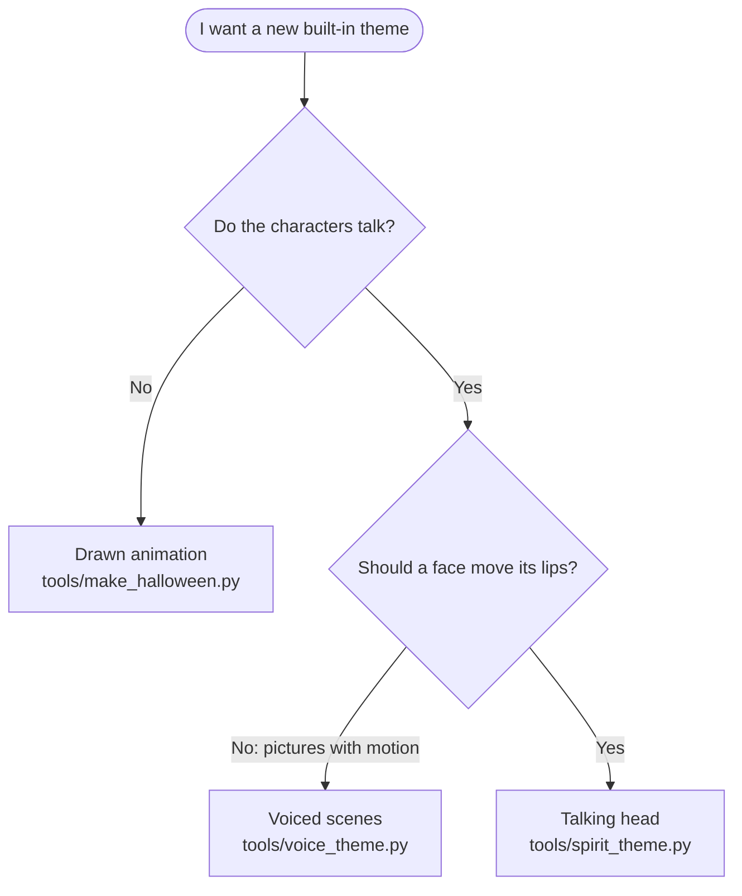
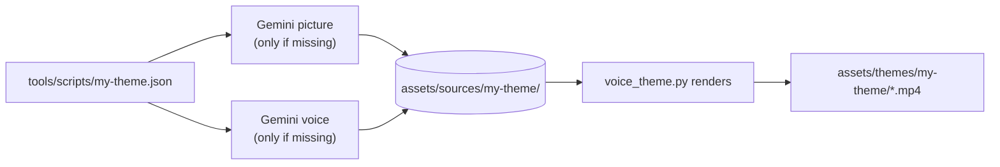

# Making themes

There are two ways to make a theme.

- **In the app** (no code): press **+ New theme** and drag in videos, GIFs or photos. The app
  converts them. This is all most people need.
- **As a built-in theme** (this page): make a theme that ships with the app, from code or from a
  script. Use this for animations, talking characters, or anything you want everyone who uses your
  copy of the app to get.

**On this page:** [The rules every clip follows](#the-rules-every-clip-follows) ·
[Pick a kind](#pick-a-kind) · [Drawn animations](#drawn-animations) · [Voiced scenes](#voiced-scenes) ·
[Talking heads](#talking-heads) · [Voices, sounds and effects](#voices-sounds-and-effects) ·
[The Gemini key](#the-gemini-key) · [Checklist for a new built-in theme](#checklist-for-a-new-built-in-theme) ·
[Content guidelines](#content-guidelines)

## The rules every clip follows

| Rule | Why |
| --- | --- |
| 480 × 480, H.264 Constrained Baseline level 3.0, yuv420p, 30 fps | The exact format of the clips that came on the ball |
| MP3 sound, 128 kb/s, 44.1 kHz stereo, always present (even if silent) | Same reason |
| Important things inside the central circle | The screen is round; the corners are hidden |
| File names start with `01-`, `02-`… | The ball plays files in name order |
| Built-in themes live in `assets/themes/<id>/` with a `theme.json` | That's where the app looks |

All the tools below follow these rules for you. `npm run test:tools` checks they still do.

## Pick a kind



| Kind | Looks like | Needs an API key? | Example |
| --- | --- | --- | --- |
| Drawn animation | Shapes drawn frame by frame in Python | No | Halloween |
| Voiced scenes | A painted picture with slow zoom, effects, a caption and a voice | Only to make new pictures and voices | Monster Parade, Fortune Teller |
| Talking head | A face that blinks and moves its mouth in time with a voice | Only to make new pictures and voices | Spirit in the Ball |

## Drawn animations

`tools/make_halloween.py` draws every frame with [Pillow](https://pillow.readthedocs.io), makes its
own sound effects with numpy, and pipes everything to ffmpeg. It draws at twice the size and shrinks
for smooth edges.

To add a clip to Halloween:

1. Write a function like `clip_pumpkin(path)`. Inside it, define `render(t)` that returns a frame for
   time `t` (use the helpers: `radial_bg`, `glow_layer`, `draw_stars`, `text_layer`, `fit_font`,
   `finish`), build the sound with `tone`, `wind` and `place`, then call
   `encode(path, seconds, render, audio)`.
2. Add it to `CLIPS` with a file name and title.
3. Run `npm run themes:halloween`.

For a new drawn theme, copy the file and change the output folder in its npm script.

## Voiced scenes

`tools/voice_theme.py` turns a script into clips. For each scene it shows one or two pictures with
a slow push-in, adds effects and a caption, makes a glow pulse with the voice, mixes in spooky
background sound, and encodes the result.



Pictures and voices are saved in `assets/sources/<id>/` and committed to git. After the first run,
rendering never calls the API again, so anyone can rebuild the theme for free and offline.

### Script format

```json
{
  "id": "my-theme",
  "name": "My Theme",
  "emoji": "🧛",
  "note": "One line shown under the theme name.",
  "art_style": "Added to the start of every picture prompt, so all pictures match.",
  "ambience": "night",
  "voice": "Charon",
  "style": "Default acting direction for every line.",
  "art": { "shared-picture": "A picture used by several scenes." },
  "scenes": [
    {
      "file": "01-hello",
      "title": "Hello!",
      "line": "Good evening... <short pause> welcome!",
      "art": "A picture just for this scene.",
      "voice": "Algenib",
      "style": "Acting direction for this line only.",
      "fx": ["bats", "fog"]
    },
    {
      "file": "02-reveal",
      "title": "A vision",
      "line": "I see... <long pause> something wonderful!",
      "shots": ["shared-picture", "another-key-in-art"]
    }
  ]
}
```

| Field | Required | Meaning |
| --- | --- | --- |
| `id` | Yes | Folder name: lowercase letters, numbers and dashes |
| `name`, `emoji`, `note` | Yes | What the app shows |
| `art_style` | Yes | Shared art direction. Ask for full-bleed pictures with no frame or border, and say the subject should sit in the central circle. |
| `ambience` | No | `night` (wind and a low drone) or `mystic` (a soft shimmering pad and chimes) |
| `voice`, `style` | No | Defaults for every scene |
| `art` | No | Named pictures that scenes can share |
| `scenes[].file` | Yes | Output file name without `.mp4`; sets the play order |
| `scenes[].title` | Yes | Caption on screen and title in the app |
| `scenes[].line` | Yes | Exactly what's said. Put sounds like `<laugh>` inline. |
| `scenes[].art` | One of these two | A picture just for this scene |
| `scenes[].shots` | | Two keys from `art`: the first shows, then dissolves into the second partway through the line |
| `scenes[].voice`, `style` | No | Override the defaults |
| `scenes[].fx` | No | Effects; see below |

### Make it

1. Write the script in `tools/scripts/`.
2. Try it with placeholders first (no API, no cost, any machine with macOS):
   ```bash
   uv run --with pillow --with numpy python tools/voice_theme.py tools/scripts/my-theme.json --draft --out /tmp/my-theme
   ```
3. Make it for real (needs [the Gemini key](#the-gemini-key)):
   ```bash
   uv run --with pillow --with numpy python tools/voice_theme.py tools/scripts/my-theme.json
   ```
4. Add an npm script for it next to `themes:monsters` in `package.json`, and add it to `themes`.

Useful options: `--only <text>` renders only scenes whose file name contains the text.

To redo one picture or one line, delete that file in `assets/sources/<id>/art/` or `voice/` and run
the command again. Only missing files are generated.

## Talking heads

`tools/spirit_theme.py` makes a face that floats inside the ball, blinks, and moves its mouth in
time with the voice.

How it works:

1. Gemini paints the head on a black background, using a reference picture so the character stays
   recognisable.
2. Gemini then edits that picture three times: mouth half open, mouth open, eyes closed.
3. The tool lines the edits up with the original, finds the mouth and eyes by comparing them, and
   blends only those regions in time with how loud the voice is.
4. The head is blended over swirling mist (black becomes see-through), floats gently, and fades in
   and out. The voice gets a soft echo.

Run with `--debug` to save `masks.png` showing the mouth (red) and eye (blue) regions it found. If
the regions look wrong, delete the variant pictures and generate them again.

### Script format

```json
{
  "id": "spirit-in-the-ball",
  "name": "Spirit in the Ball",
  "emoji": "🕯️",
  "note": "One line shown under the theme name.",
  "reference": "fortune-teller/art/zara.jpg",
  "head": "Prompt for the head: front-facing, eyes open, lips closed, pure black background...",
  "variants": {
    "mouth-mid": "Edit: keep everything the same except lips slightly parted.",
    "mouth-open": "Edit: keep everything the same except mouth open in an 'oh'.",
    "blink": "Edit: keep everything the same except eyes closed."
  },
  "voice": "Sulafat",
  "style": "Acting direction for every line.",
  "scenes": [{ "file": "01-awaken", "title": "The spirit awakens", "line": "Ooooh... who knocks?" }]
}
```

`reference` is a picture under `assets/sources/` (optional in spirit, but it keeps a character
consistent). The variants must keep the head in exactly the same place; the prompts above say so.

Commands are the same as for voiced scenes, using `tools/spirit_theme.py`.

## Voices, sounds and effects

**Voices** (Gemini's prebuilt voices; pick by feel):

| Voice | Feel | Voice | Feel | Voice | Feel |
| --- | --- | --- | --- | --- | --- |
| Zephyr | Bright | Puck | Upbeat | Charon | Informative, deep |
| Kore | Firm | Fenrir | Excitable | Leda | Youthful |
| Orus | Firm | Aoede | Breezy | Callirrhoe | Easy-going |
| Autonoe | Bright | Enceladus | Breathy | Iapetus | Clear |
| Umbriel | Easy-going | Algieba | Smooth | Despina | Smooth |
| Erinome | Clear | Algenib | Gravelly | Rasalgethi | Informative |
| Laomedeia | Upbeat | Achernar | Soft | Alnilam | Firm |
| Schedar | Even | Gacrux | Mature | Pulcherrima | Forward |
| Achird | Friendly | Zubenelgenubi | Casual | Vindemiatrix | Gentle |
| Sadachbia | Lively | Sadaltager | Knowledgeable | Sulafat | Warm |

**Acting** goes in `style` ("deep and theatrical, playful rather than scary"). **Sounds** go inline
in the line, in angle brackets, where they should happen:

`<laugh>` `<chuckle>` `<giggle>` `<cackle>` `<snicker>` `<growl>` `<groan>` `<hiss>` `<gasp>`
`<sigh>` `<yawn>` `<breath>` `<whispers>` `<scream>` `<shriek>` `<cough>` `<sneeze>` `<snort>`
`<short pause>` `<long pause>`

**Effects** for voiced scenes (`fx`):

| Effect | Looks like |
| --- | --- |
| `bats` | Small bats flapping across the top |
| `fog` | Drifting fog, thickest at the bottom |
| `embers` | Orange sparks rising |
| `dust` | Floating dust motes |
| `sparkles` | Twinkling stars |
| `moon-glow` | A soft glow pulsing at the top right |
| `lightning` | Two quick flashes |

## The Gemini key

Only needed to make **new** pictures or voices. Rendering from saved files never needs it.

1. Get a key at [Google AI Studio](https://aistudio.google.com/apikey).
2. Make a file called `.env` in the repo folder:
   ```
   GEMINI_API_KEY=your-key-here
   ```
   `.env` is git-ignored, so it won't be committed. You can also set `GEMINI_API_KEY` in your shell,
   or point `GEMINI_API_KEY_FILE` at a private file that holds only the key.
3. `npm run doctor` shows whether a key is set (it never prints it).

Models are `gemini-nano-banana-2.1` for pictures and `gemini-3.8-flash-tts` for voices. To use
others, set `CRYSTAL_BALL_IMAGE_MODEL` or `CRYSTAL_BALL_TTS_MODEL`.

## Checklist for a new built-in theme

- [ ] Script in `tools/scripts/` (or a function in a drawing tool)
- [ ] Tried with `--draft` first
- [ ] Generated sources in `assets/sources/<id>/` (for voiced and talking-head themes)
- [ ] npm script added, and included in `npm run themes`
- [ ] `npm run test:tools` and `npm test` pass
- [ ] Looked at it with **▶ Preview** in the app
- [ ] Added to the themes table in the README

## Content guidelines

- **It plays to children at the front door.** Spooky-funny, never gory or mean.
- **Keep lines short.** 5 to 15 seconds each is about right.
- **No copyrighted characters.** Use original characters, or ones from public-domain stories, and
  avoid copying a particular film's look. A theme for a franchise can ship empty, for clips the
  family owns.
- **Say where generated content came from** in the README's credits.
